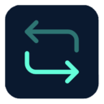

<h1 align="center">MirrorTab</h1>

  
   
  <em>Mirror DOM interactions from a source tab to a target tab in real time.</em>
   

  <a href="CONTRIBUTING.md">Contributing Guidelines</a>
  ·
  <a href="https://github.com/KostaD02/MirrorTab/issues">Submit an Issue</a>
  ·
  <a href="https://chromewebstore.google.com/detail/mirrortab/bljopdbabofhephejfdlmclnjjipihpb">Chrome Web Store</a>
   

  

MirrorTab is a Chrome extension that captures user interactions on one browser tab (the **source**) and replays them live on one or more target tabs. It supports clicks, keyboard input, form changes, scrolling, and mouse movement - with session recording and export built in.

## Features

- **Live mirroring** - clicks, inputs, keystrokes, scroll events, and mouse movement are forwarded from the source tab to every target tab in real time
- **Multi-target sync** - mirror a single source to multiple targets at once; add up to 10 target URLs per session and manage each one independently
- **Ghost cursor** - a virtual cursor on the target tab shows exactly where the source user is pointing and clicking
- **Session control** - start, pause, resume, and stop a mirroring session from the popup
- **Role badges** - a floating badge on each tab shows whether it is SOURCE or TARGET
- **Session recording** - all events replayed on the target tab are recorded with timestamps
- **Export** - download the recorded session as JSON or plain text before or after stopping
- **Standalone Replay Engine** - upload previously exported session files to an isolated Replay tab to automatically replay all recorded user actions with full playback controls (play, pause, stop, adjust speed)
- **Smart selector** - elements with an `id` are resolved via `#id`; all others use a full structural CSS path, keeping replay accurate across DOM changes
- **Settings** - a preferences panel in the popup for privacy, overlays, which events to mirror, and playback; saved locally and applied to running sessions immediately

The production bundle can be downloaded from [releases](https://github.com/KostaD02/MirrorTab/releases).

## Usage

1. Click the **MirrorTab** icon in the Chrome toolbar to open the popup
2. Enter a **Source URL** and one or more **Target URLs** (click **+ Add Target** for additional targets)
3. Click **Start Session** - the source tab and all target tabs will open automatically
4. Interact with the **SOURCE** tab; every action is mirrored to all **TARGET** tabs in real time
5. Use **Pause / Resume** to temporarily suspend mirroring without closing the session
6. Remove individual targets from an active session without stopping the whole session
7. Use **Download JSON** or **Download Text** to export the full event log from each target tab at any time
8. Click **Stop** to end the entire session - recorded events are cleared

### Replaying a saved session

1. Click the **Replay Page** button in the MirrorTab extension popup
2. Upload your downloaded `.json` or `.txt` session log file
3. Enter the URL of the environment you want to test the replay on
4. Click **Start** to spawn the Replay tab and watch the automated execution

## Settings

Open the **gear icon** in the popup header. Changes are saved to `chrome.storage.local` and picked up by every open tab straight away - no need to restart a session.

| Setting                   | Default | Effect                                                                                    |
| ------------------------- | ------- | ----------------------------------------------------------------------------------------- |
| **Mirror password fields** | On      | Turn off to keep values and keystrokes from credential inputs out of target tabs and exported logs |
| **Show ghost cursor**     | On      | The virtual pointer drawn on target and replay tabs                                       |
| **Show role badge**       | On      | The floating SOURCE / TARGET / REPLAY label - turn off for clean screenshots and demos    |
| **Mouse movement**        | On      | Forward `mousemove`. The highest-volume event; turning it off sharply reduces message traffic |
| **Scrolling**             | On      | Forward scroll position changes                                                            |
| **Keystrokes**            | On      | Forward `keydown` / `keyup`, which are separate from typed input values                   |
| **Smooth scrolling**      | On      | When off, replayed scrolls jump instantly, which keeps fast scrolling in sync              |
| **Scroll debounce**       | 50 ms   | Quiet period before a settled scroll position is forwarded (0-2000 ms)                    |
| **Staggered tab opening** | 0 ms    | Delay between each target tab opening (0-60000 ms). `0` opens them all at once            |

### Staggered tab opening

Some sites rate-limit or throttle a burst of simultaneous page loads. Setting a stagger opens the target tabs one delay apart instead of all at once.

All tabs still appear immediately so you can see the full set, but each target parks on a MirrorTab waiting page showing a live countdown and the URL it is queued for. The session becomes active as soon as the source tab is ready - each target joins as its timer elapses, so the popup is never left waiting on a long queue.

> **Password fields are mirrored by default**, so login flows keep working as before. While it is on, credentials reach the target tabs and appear in plaintext in exported session logs - turn it off when mirroring anything you would not want in an exported file. Credential inputs are detected by `type="password"` and by `autocomplete="current-password"` / `"new-password"`, so fields unmasked by a "show password" toggle are covered too.

## Recorded event format

Each entry in the exported session log contains:

| Field                | Description                                                                       |
| -------------------- | --------------------------------------------------------------------------------- |
| `timestamp`          | ISO 8601 timestamp of when the event was replayed                                 |
| `type`               | Event type: `click`, `input`, `change`, `keydown`, `keyup`, `scroll`, `mousemove` |
| `selector`           | Compact element identifier: `TAG#id#firstClass#attr=val`                          |
| `selectorStackTrace` | Full CSS structural path used for DOM resolution                                  |
| `content`            | Event-specific payload (coordinates, value, key info, scroll position)            |

## Permissions

| Permission | Reason                                                            |
| ---------- | ------------------------------------------------------------------- |
| `storage`  | Persist the active session and your settings across service worker restarts |

## Contributing

Bug reports and feature requests are welcome via [GitHub Issues](https://github.com/KostaD02/MirrorTab/issues).

Please refer to our [Contributing Guidelines](CONTRIBUTING.md) for details on our code of conduct, development setup, and the process for submitting pull requests to us.

## Security

Please review our [Security Policy](SECURITY.md) for information on supported versions and details regarding how to responsibly report security vulnerabilities.

## License

[MIT](./LICENSE) © Konstantine Datunishvili
